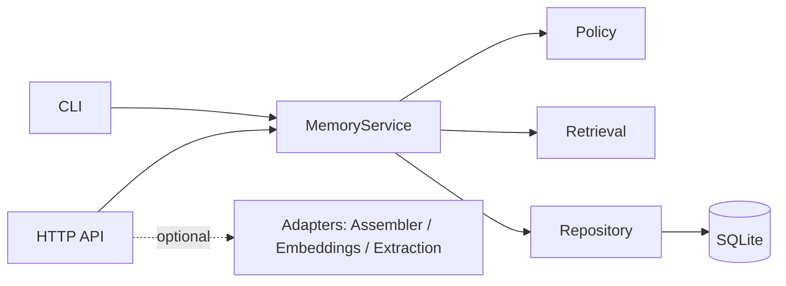

# Architecture

Status: current for v0.5.1 · Audience: contributors and operators

This document describes how the engine is put together, which behaviors it
guarantees, and which trade-offs were chosen. It intentionally avoids product
or portfolio commentary; see [requirements](requirements.md),
[verification](verification.md), and the
[review report](review-2026-10-19.html) for the specification and evidence.

## 1. Purpose

Language models do not keep state between requests. An agent that needs to
continue a task, remember a previous session, or reuse a stable preference
needs an external memory. Storing every message forever is not a solution: it
is expensive, noisy, and risky.

The engine provides a small, persistent memory with three questions:

| Tier | Question | Typical content | Default lifetime |
|---|---|---|---|
| `working` | Where are we in the current task? | "2 of 3 documents reviewed; the third is pending" | 24 hours |
| `episodic` | What happened, and what was the result? | "The IAM policy exercise was repeated in the 19 Oct session" | 90 days |
| `semantic` | What is durable and reusable? | "The user prefers Turkish explanations with examples" | No automatic expiry |

The engine returns candidate context with scores and provenance. Deciding
which candidates fit a token budget belongs to the caller (for example the
Dynamic Context Assembler).

## 2. Scope and non-goals

In scope:

- Persistent storage with per-user isolation.
- Explicit create, update, retrieve, expire, and delete operations.
- TTL, quotas, optional eviction, versioning, and idempotency.
- Optional adapters for context assembly, embeddings, and controlled
  extraction.
- A local CLI and an optional HTTP boundary.

Out of scope:

- Model training, fine-tuning, or a correctness guarantee.
- Distributed storage, replication, or multi-node coordination.
- A required live LLM or embedding provider.
- A user interface, identity provider, or observability platform.
- Enterprise DLP or regulatory compliance.

## 3. Guarantees and non-guarantees

Guaranteed:

- Every read and write is filtered by `tenant_id` and `user_id`.
- Retrieval returns only `active`, unexpired records. `working` records are
  additionally scoped by `session_id` and `task_id`.
- Updates use optimistic concurrency through `expected_version`.
- Repeating a request with the same idempotency key does not create a second
  record.
- Deleting a record also removes its versions, dependencies, embeddings, and
  related operation caches.
- Quota exhaustion is an explicit `quota_exceeded` error by default.
- Ordering is deterministic: score first, then `id`.
- Errors use stable codes and non-leaking messages.

Not guaranteed:

- Semantic understanding. `relevance` is lexical overlap, not an embedding
  similarity claim.
- Embedding quality. `HashEmbedder` is an offline integration stub.
- Scale. SQLite is single-node; there is no horizontal scaling claim.
- LLM correctness. Extracted semantic facts remain `candidate` records.
- DLP. Secret and prompt-injection filters are a layer, not a compliance
  product.

## 4. Architecture



Dependencies point downward: the core (`models`, `policies`, `retrieval`) does
not know about HTTP, SQLite, or external providers. Adapters translate between
the core and outside systems.

| Module | Responsibility | External dependency |
|---|---|---|
| `models.py` | `Memory`, `MemoryInput`, `Scope`, validation, JSON encoding | None (stdlib) |
| `policies.py` | TTL, half-life, quotas, candidate and `top_k` limits, eviction | None |
| `retrieval.py` | Unicode/Turkish tokenization, lexical relevance, recency, final score | None |
| `repository.py` | SQLite connection, migrations, transactions, cascade deletes | `sqlite3` |
| `service.py` | Business rules: create/update/retrieve/delete, quota, contradiction, cycles | Core modules |
| `adapters/context_assembler.py` | Converts candidates to the assembler contract; limits and provenance | Optional assembler |
| `adapters/embeddings.py` | Embedder protocol, hash embedder, `EmbeddingIndex` with RRF | None (vectors stored as JSON) |
| `adapters/extraction.py` | Controlled LLM summary/fact extraction; quote requirement; candidates | Optional provider |
| `api.py`, `api_middleware.py` | FastAPI boundary, authentication, body/rate/concurrency limits, metrics | FastAPI (optional) |
| `cli.py` | JSON command-line interface without HTTP | None |

## 5. Data model

```text
memories(id PK, tenant_id, user_id, tier, status, expires_at,
         session_id, task_id, fact_key, importance, verification_status,
         created_at, payload JSON, size_bytes)
  unique(tenant_id, user_id, fact_key) where tier='semantic' and status='active'

versions(memory_id FK -> memories on delete cascade, version, payload)
  primary key(memory_id, version)

idempotency(tenant_id, user_id, key, payload_hash, memory_id FK)
  primary key(tenant_id, user_id, key)

dependencies(derived_id FK, source_id FK)
  primary key(derived_id, source_id)

embeddings(memory_id PK FK, model_id, model_version, dimension, content_hash, vector)

operations(tenant_id, user_id, operation_id, fingerprint, result)
  primary key(tenant_id, user_id, operation_id)

operation_sources(tenant_id, user_id, operation_id, source_id FK)
operation_outputs(tenant_id, user_id, operation_id, memory_id FK)
```

Design notes:

- **JSON payload plus typed columns.** Filter columns (`scope`, `tier`,
  `status`, `expires_at`) are indexed; the rest can evolve without a migration
  for every new field.
- **Partial unique index `active_fact`.** A semantic `fact_key` can have only
  one active record. `candidate` and `superseded` rows are outside the
  constraint.
- **`versions`.** Each update stores the previous payload for audit and
  rollback. Under quota pressure the oldest version payloads are reclaimed;
  the live payload in `memories` is never the one removed.
- **`dependencies`.** A derived record points to its sources. Changing a
  source invalidates its derivatives; cycles are rejected.
- **`operations` and `operation_outputs`.** Idempotent operations remember
  which records they produced, so deletion can clean the cache too.
- **`embeddings`.** Vectors are stored as JSON with model id, version, and a
  content hash used to detect staleness.

## 6. Write path

`create`:

1. Validate the input (`tier`, Unicode, NaN/infinity, sizes, required fields).
2. Require a `Scope`; `working` also requires `session_id` and `task_id`.
3. Check idempotency: same key and payload hash returns the previous result;
   a different hash returns `idempotency_conflict`.
4. Apply the contradiction policy for semantic `fact_key` collisions.
5. Validate `memory:` sources: same scope, active, unexpired, and acyclic.
6. Enforce quota (expired cleanup, optional eviction, or `quota_exceeded`).
7. Write record, version, dependencies, idempotency row, and operation outputs
   in one transaction. Any failure rolls the whole unit back.

`update`:

```text
if content or source_refs changed:
    for each memory: source:
        require(identifier not in ancestors(source), "source_cycle")
    delete descendants
    relink sources
```

The cycle check runs **before** descendants are deleted. Otherwise a source
would already be gone at relink time and the caller would see a misleading
`not_found`. The update is rejected with `source_cycle`; the previous state is
preserved.

Contradiction policy for semantic facts:

- An authoritative user correction supersedes the previous active record in
  the same transaction.
- An untrusted or extracted value cannot overwrite verified knowledge; it is
  stored as `candidate`.
- `candidate` and `superseded` records never appear in normal retrieval. They
  remain inspectable by identifier.

## 7. Read path

1. SQL filters: scope, `status='active'`, not expired, tier, and for `working`
   the session/task pair.
2. Candidate bound: at most `max_candidates` rows. Exceeding the bound
   truncates the candidate set; it does not fail the request.
3. Validity filter: derived records whose sources were deleted or expired are
   removed.
4. Lexical relevance: Unicode normalization, Turkish `İ → i` / `I → ı`,
   casefold, token overlap. Results below `min_relevance` are dropped.
5. Score and order:
   `0.60 × relevance + 0.25 × recency + 0.15 × importance`, ties by `id`.
6. Apply `top_k` (default 10, maximum 100).

```text
recency = 2 ** (-age_days / half_life_days)
score   = 0.60*relevance + 0.25*recency + 0.15*importance

example: relevance 1.0, age 30d, half-life 30d, importance 0.8
recency = 0.5
score   = 0.600 + 0.125 + 0.120 = 0.845
```

Every result carries id, tier, content, sources, relevance, recency,
importance, final score, and the reason it was selected.

### Hybrid search (optional)

`EmbeddingIndex` combines a lexical ranking and a cosine ranking with
Reciprocal Rank Fusion:

```text
fused      = Σ 1 / (60 + rank)
normalized = fused / (2 / 61)
```

`HashEmbedder` is not a semantic model; it exists to exercise the integration
offline. Measured on the synthetic set, it increased false recall on unrelated
queries, so lexical search remains the default. Changing the model, version,
dimension, or content hash returns `reindex_required`.

## 8. Lifecycle and deletion

| Status | Meaning | Visible in retrieval |
|---|---|---|
| `active` | Current, usable record | Yes, while unexpired |
| `candidate` | Unverified proposal (for example an extraction) | No |
| `superseded` | Replaced by a newer verified value | No |

TTL affects visibility immediately and physical cleanup later. An expired
record is not returned even before a cleanup pass runs.

Deleting a record cascades to versions, dependencies (both sides),
embeddings, idempotency entries, operation outputs, and operation sources.
No content-free audit log is kept. `delete_user_data` removes the whole scope.

## 9. Capacity

| Policy | Default |
|---|---|
| `working` TTL / half-life | 24 hours / 1 day |
| `episodic` TTL / half-life | 90 days / 30 days |
| `semantic` TTL / half-life | No automatic expiry / 180 days |
| Records per user + tier | 1,000 |
| Bytes per user + tier | 4 MiB (record and version payloads) |
| Content / metadata / sources | 16 KiB / 4 KiB / 64 sources |
| Query / `top_k` / candidates | 4 KiB / 100 / 3,000 |
| Minimum lexical relevance | 0.05 |
| Eviction | Off by default; when enabled, importance < 0.3, then oldest-first, then id |
| Adapter | 100 items, 64 KiB payload |

Quotas are logical limits, not the physical SQLite file size. When eviction is
enabled, pressure is relieved in this order: expired cleanup, oldest version
payload reclamation, then low-importance record eviction. Verified semantic
records and the sources of verified derivatives are protected. If space is
still unavailable, the write fails with `quota_exceeded` and rolls back.

## 10. Security model

- **Scope comes from authentication.** The HTTP layer maps a bearer token to a
  `Scope`. Body fields for tenant or user are rejected. A caller cannot choose
  another user's scope.
- **Fail closed.** Development identity is available only with
  `MEMORY_DEVELOPMENT=1`. Without an authenticator, the application refuses to
  start.
- **Stable error surface.** 401 identity, 404 out-of-scope or missing, 409
  version/idempotency conflict, 413 oversized body, 422 validation, 429
  quota/rate/concurrency, 503 storage. Messages do not echo content.
- **Limits.** Body 64 KiB, concurrency 16 per process, search 120/min, query
  4 KiB, `top_k` 100.
- **Per-principal search window.** The search rate window is keyed by the
  bearer-token hash (falling back to the client host), so an unauthenticated
  caller cannot exhaust another caller's budget. A shared gateway limit is
  still required for multi-worker deployments.
- **Logging.** Request id, status, and duration only. Content, URLs, tokens,
  identity, and exception text are not logged.

## 11. Context assembler integration

The engine returns candidates; the assembler decides what fits the budget.

```text
assemble_memories(results, query, budget, assembler=assemble)
  -> {selected, dropped, retrieved, source_mapping, assembly}
```

Notes:

- The assembler's `working_memory` field is an assembly **category**, not the
  storage tier. The tier travels in each item's `tier` and `source_refs`.
- The adapter writes the engine's `final_score` into the assembler's
  `importance` field.
- `required` is `False`; provenance and drop reasons are preserved.
- The optional sibling package is not required to run the core test suite.
  Integration tests skip when it is unavailable.

## 12. Verification

- `python -m pytest -q`: 81 passed.
- `ruff check` and `ruff format --check`: clean.
- CI (`offline-tests`): Python 3.11 and 3.13 matrix plus a container smoke job,
  green on `main`.
- Isolation and lifecycle fuzzing: zero violations across random scopes.
- Synthetic Turkish evaluation: precision/recall, false recall on unrelated
  queries, and p50/p95 latency. Lexical is the default; hybrid is reported
  honestly, including its worse false-recall result.

The detailed record is in [verification.md](verification.md); evaluation output
is in [`evaluations/results-v1.json`](../evaluations/results-v1.json).

## 13. Review findings and disposition

| ID | Severity | Finding | Disposition |
|---|---|---|---|
| B1 | Critical | Symbol-only content or query produced a zero vector and broke hybrid indexing | Fixed; regression test |
| B2 | Critical | Version history counted against quota but was never reclaimed, eventually blocking updates | Fixed; oldest version payloads reclaimed under pressure |
| B3 | Medium | Global pre-auth search window let anonymous callers exhaust valid callers' budget | Fixed; window keyed per principal |
| B4 | Low | A cycle attempt returned `not_found` instead of `source_cycle` | Fixed; cycle checked before descendant deletion |
| B5 | Low | Exceeding the candidate bound failed the whole search | Fixed; candidates truncate at the bound |
| B6 | Note | Middleware swallowed the exception class; logging was weak | Documented |
| B7 | Note | `hybrid_fake` wording could imply a quality gain that was not measured | Documented |
| B8 | Note | Tests were hard-coupled to the sibling assembler project | Fixed for the public repo: optional import and non-fatal CI checkout |

Evidence and before/after probes: [review-2026-10-19.html](review-2026-10-19.html).

## 14. Design decisions and trade-offs

| Decision | Reason | Cost / when it changes |
|---|---|---|
| SQLite | Zero setup, one file, offline tests, clear transactions | PostgreSQL/pgvector when horizontal scale is required |
| JSON payload plus indexed filter columns | Schema evolution while keeping filters indexable | Normalize when field-level analytics is needed |
| Lexical default | Deterministic, explainable, no network | A measured real embedder can make hybrid the default |
| No automatic capture | Do not persist mistakes; privacy | Product decision; still gated by candidate/approval flow |
| UUID plus version | Distributed creation and optimistic locking | Conflicts surface as 409 |
| Cascade delete, no tombstones | Data minimization and a real "forget" path | A separate content-free event log can be added |
| Eviction off by default | Avoid surprising data loss | Enable with an explicit policy for high-volume products |

## 15. References

- [Requirements](requirements.md) — locked behavior contract.
- [Verification](verification.md) — test and measurement record.
- [Review report](review-2026-10-19.html) — findings and evidence.
- [Runbook](runbook.md) — backup, migration, deletion, Docker.
- [Learning guide](learning-guide.md) — design questions and answers.
- [Changelog](../CHANGELOG.md) — release history.
